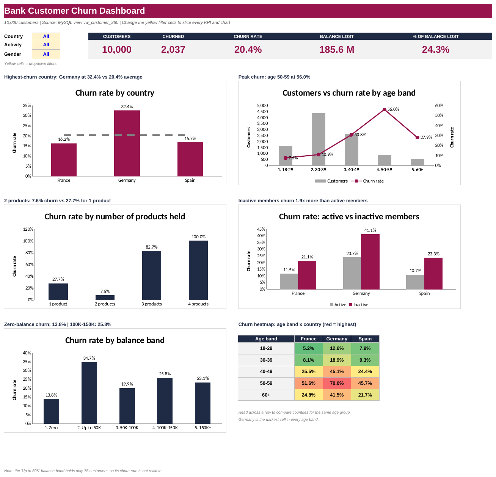

# Bank Customer Churn Analysis (SQL + Excel)

A bank was losing **20.37%** of its customers, and they took **24.3% of all balances** with them. This project finds which customer segments drive that churn, where the lost money is concentrated, and what retention would be worth.

**Tools:** MySQL 8.0 · Microsoft Excel (Power Query, PivotTables, charts)
**Data:** Kaggle `Churn_Modelling.csv`: 10,000 customers of a European bank (France, Germany, Spain), 14 columns



## Key findings

| Finding | Evidence |
|---|---|
| Germany is the biggest problem | 32.4% churn vs 16–17% elsewhere; 25% of customers but 40% of churners and 53% of balance lost. The gap holds like-for-like (customers with a balance: 32.4% vs 18–20%) |
| Age 40–59 is the core risk group | 50–59 churn at 56.0%, 40–49 at 30.8%; 35% of customers but 63.5% of churners |
| Inactive members churn 1.9× more | 26.9% vs 14.3%, in every country and every age band |
| Two products is the sweet spot | 7.6% churn with 2 products vs 27.7% with 1 and 83–100% with 3–4 (only 326 customers) |
| Risk is concentrated | 10 segments hold 30% of customers but 58% of churners and 62% of lost balance |
| Some attributes don't matter | Credit score, credit card and tenure all fall within 18.6–22.0% churn |

**Impact (scenario):** a 15% churn reduction in the 40–59 group would keep ~194 customers and ~17.5M in balance (9.4% of all balance lost).

## Approach

1. **Load:** raw CSV into a staging table (`01_setup_and_load.sql`)
2. **Validate:** 7 data-quality checks; all pass (`02_data_quality.sql`)
3. **Model:** 5 related tables, a segment lookup table joined with range (non-equi) joins, and one analysis view `vw_customer_360` (`03_schema_and_transform.sql`)
4. **Analyse:** 11 queries using joins, GROUP BY/HAVING, CTEs, conditional aggregation and window functions (RANK, DENSE_RANK, ROW_NUMBER, NTILE, LAG, running totals) (`04_analysis.sql`)
5. **Present:** Excel workbook with 7 PivotTables, a filterable dashboard, SQL-vs-Excel reconciliation (31/31 match), a 150-customer retention priority list and a scenario model

## Repository structure

```
data/      put Churn_Modelling.csv here (download it from Kaggle; not included in this repo)
sql/       01-04 project scripts, 05 practice exercise answers
outputs/   every query result as CSV
excel/     Bank_Churn_Analysis.xlsx
images/    charts and diagrams
report/    Project_Report.docx: full write-up and study guide
```

## How to run

1. Install MySQL 8.0 and MySQL Workbench. In the Workbench connection settings, add `OPT_LOCAL_INFILE=1` under Advanced > Others, then run `SET GLOBAL local_infile = 1;`.
2. Edit the file path in `sql/01_setup_and_load.sql`, then run scripts 01 → 04 in order.
3. Open `excel/Bank_Churn_Analysis.xlsx` and click **Data > Refresh All**.

## Limitations

The data is a single snapshot with no dates, so the analysis is descriptive, not predictive. Correlation is not causation (inactivity may be a symptom of churn). Some groups are too small to trust (3–4 products, the "Up to 50K" balance band). The retention ranking is a rule-based heuristic. The currency is not stated in the source data.

**Next step:** a logistic regression or tree model for individual churn probability, validated on held-out data.
